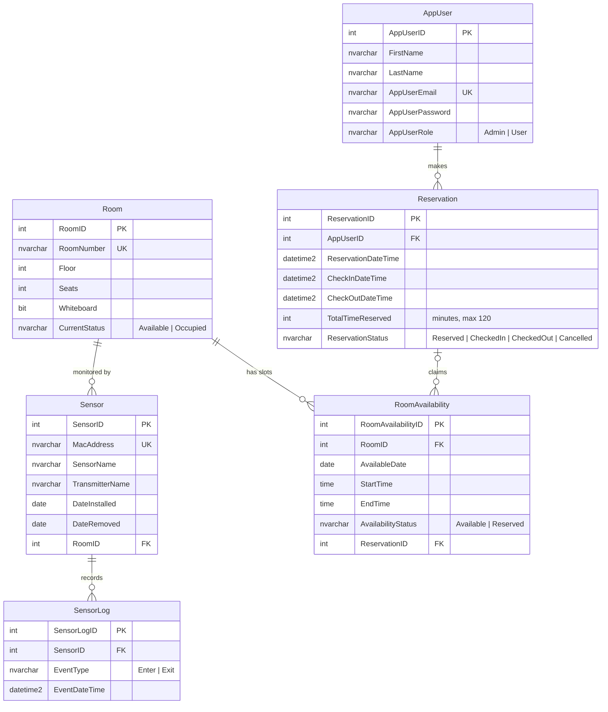

# RoomRec — Study Room Reservation System

A SQL Server database for reserving campus study rooms and tracking whether they're occupied in real time. Users book rooms in 15-minute blocks, and presence sensors in each room log people entering and leaving, so the database always knows each room's current status.

Built for MIST 460.

## Features

- **15-minute booking slots.** Each room's day (8:00 AM – 8:00 PM) is split into 15-minute availability slots.
- **Reservations from 15 minutes to 2 hours.** A booking claims a run of back-to-back slots in a single transaction, so two users can't take the same slot.
- **Booking rules enforced in the database.** No bookings in the past, no overlapping bookings for the same user, and every requested slot must be free.
- **Cancellation.** Only the user who made a reservation can cancel it, and only before check-in. Its slots become available again, and the reservation row is kept for history.
- **Live occupancy.** Each room has a sensor (LD2410C presence radar + ESP32-S3) that reports `Enter` / `Exit` events. A trigger updates the room's `CurrentStatus` to `Occupied` or `Available`.

## Data Model



## Programming Objects

### Stored procedures

| Procedure | Purpose |
|---|---|
| `procRecordEvent @MacAddress, @EventType` | Logs an `Enter` / `Exit` event from the sensor with that MAC address, timestamped in Eastern time. |
| `procUpdateRoomStatus @RoomID, @EventType` | Sets a room's `CurrentStatus`. Called by `trgUpdateRoomStatus`. |
| `procCreateRoomAvailabilityForOneDay @CurrentDate` | Creates the 15-minute slots from 8 AM to 8 PM for every room on one date. |
| `procCreateRoomAvailabilityForNext7Days` | Creates slots for today and the next 6 days. |
| `procCreateRoomAvailabilityBetweenDates @StartDate, @EndDate` | Creates slots for every date in a range, including both ends. |
| `procCreateReservation @AppUserID, @RoomID, @ReservationDate, @StartTime, @EndTime` | Books a range of slots and returns the new `ReservationID`. |
| `procCancelReservation @ReservationID, @AppUserID` | Cancels a reservation and frees its slots. |

### Triggers

| Trigger | Table | Purpose |
|---|---|---|
| `trgUpdateRoomStatus` | `SensorLog` (after insert) | Sets the room to `Occupied` on `Enter` and `Available` on `Exit`. |
| `trgUpdateRoomAvailabilityOnReservation` | `RoomAvailability` (after update) | Keeps `AvailabilityStatus` in sync with `ReservationID`: a slot linked to a reservation is `Reserved`, and an unlinked slot is `Available`. A manual change to the status gets overwritten. |

### Custom errors

| Code | Raised by | Meaning |
|---|---|---|
| 50001 | `procCreateReservation` | Reservation is shorter than 15 minutes or longer than 2 hours. |
| 50002 | `procCreateReservation` | One or more requested slots are taken, misaligned, or outside open hours. |
| 50003 | `procCreateReservation` | Requested time is in the past. |
| 50004 | `procCreateReservation` | User already has an overlapping active reservation. |
| 50005 | `procCancelReservation` | Reservation not found, not owned by this user, or no longer cancellable. |

## Getting Started

### Prerequisites

- Microsoft SQL Server (2016 or later, since the scripts use `create or alter` and `at time zone`)
- A SQL client such as SSMS, Azure Data Studio, or VS Code with the MSSQL extension

### Setup

Run the scripts in [`Data/RDB/`](Data/RDB/) in this order:

1. [`CreateTables.sql`](Data/RDB/CreateTables.sql) drops and recreates all tables.
2. [`InsertData.sql`](Data/RDB/InsertData.sql) loads sample rooms, sensors, and users.
3. [`ProgrammingObjects.sql`](Data/RDB/ProgrammingObjects.sql) creates the procedures and triggers.

Then create availability slots for the dates you want to book:

```sql
execute procCreateRoomAvailabilityForNext7Days;
-- or
execute procCreateRoomAvailabilityBetweenDates '2026-10-27', '2026-10-30';
```

### Sample data

| Room | Floor | Seats | Whiteboard |
|---|---|---|---|
| REH 4213 | 4 | 4 | ✅ |
| REH 4225 | 4 | 6 | — |
| REH 5213 | 5 | 4 | ✅ |
| REH 5225 | 5 | 6 | — |

Each room has one sensor (`00:1A:2B:3C:4D:01` through `:04`). There are four users: one admin (Alice) and three regular users.

## Usage Examples

```sql
-- book Room 1 from 10:00 to 11:00 (4 slots) for user 2
execute procCreateReservation 2, 1, '2026-10-28', '10:00', '11:00';

-- see the claimed slots
select * from RoomAvailability
where RoomID = 1 and AvailableDate = '2026-10-28'
order by StartTime;

-- cancel it (only user 2 can)
execute procCancelReservation 1, 2;

-- simulate the sensor in Room 1 detecting someone
execute procRecordEvent '00:1A:2B:3C:4D:01', 'Enter';
select RoomNumber, CurrentStatus from Room;   -- REH 4213 is now 'Occupied'
```

More test cases, including each error path, are in the comment block at the end of [`ProgrammingObjects.sql`](Data/RDB/ProgrammingObjects.sql).

## Project Structure

```
.
├── Data/
│   └── RDB/
│       ├── CreateTables.sql        # schema: tables, keys, check constraints
│       ├── InsertData.sql          # sample rooms, sensors, users
│       └── ProgrammingObjects.sql  # stored procedures and triggers
├── LICENSE
└── README.md
```

## License

Released under the [MIT License](LICENSE).
